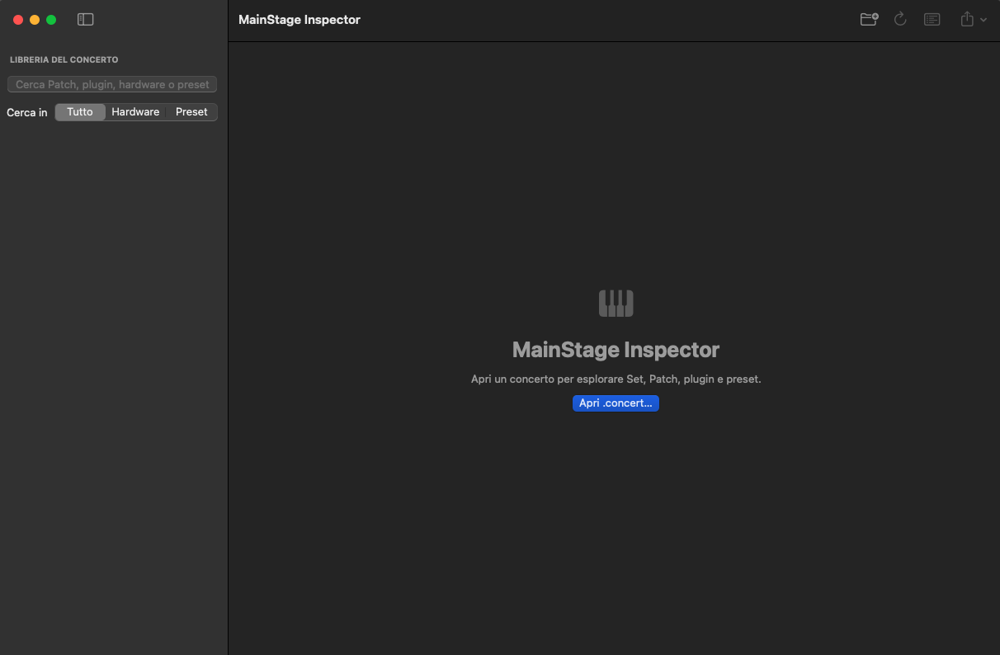
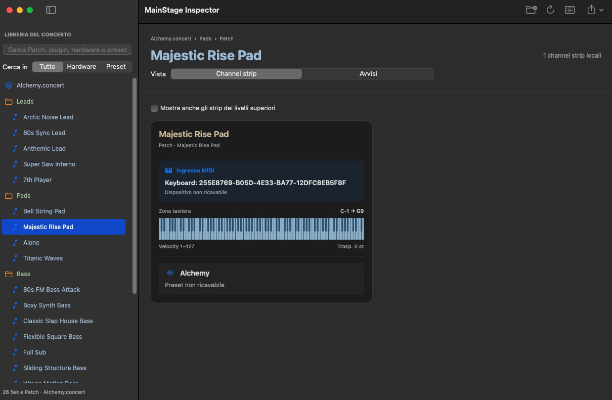

# MainStage Inspector

[English](README.md) · **Italiano**

Versione pubblica iniziale: **1.0.0**, build **13**.

App macOS per esplorare i concerti Apple MainStage in sola lettura, senza eseguire i plugin audio. Mostra Set, Patch, channel strip, strumenti, effetti, preset riconosciuti e assegnazioni MIDI salvate. Include filtri, riepilogo del concerto e report HTML/JSON.

## Download

**[Scarica MainStage Inspector 1.0.0 per Apple Silicon](https://github.com/smartrecovery73/mainstage-inspector/releases/download/v1.0.0/MainStage-Inspector-1.0.0-AppleSilicon.pkg)**

[Release e allegati](https://github.com/smartrecovery73/mainstage-inspector/releases/tag/v1.0.0) · [Manuale HTML](https://github.com/smartrecovery73/mainstage-inspector/releases/download/v1.0.0/Manuale-MainStage-Inspector.html) · [Checksum SHA-256](https://github.com/smartrecovery73/mainstage-inspector/releases/download/v1.0.0/SHA256SUMS.txt)

Per installare l’app usa il file `.pkg`; gli archivi “Source code” contengono invece i sorgenti per gli sviluppatori.

## Screenshot

Avvio dell’app:



Analisi di un concerto e dettagli della channel strip:



## Requisiti e utilizzo

L’interfaccia della versione 1.0.0 è in italiano. Sono disponibili il [manuale italiano](packaging/Manuale.html) e il [manuale inglese](packaging/Manual.en.html).

La distribuzione autonoma richiede macOS 15 o successivo e Apple Silicon (M1 o successivo). MainStage e Python non devono essere installati per analizzare i file con l’app distribuita.

L’installer colloca l’app in `/Applications`. All’avvio l’app è vuota; usa **Apri concerto** e scegli un pacchetto `.concert`. Il manuale è disponibile nel menu Aiuto e in [packaging/Manuale.html](packaging/Manuale.html).

La distribuzione attuale usa una firma locale ad hoc; non è firmata Developer ID né notarizzata. macOS può richiedere un’autorizzazione nelle impostazioni di sicurezza. Non disabilitare le protezioni del sistema.

## Sviluppo e test

Il parser usa Python 3 e la sua libreria standard. Alcuni stati compressi richiedono libzstd, inclusa nella distribuzione autonoma.

```sh
python3 -m unittest discover -v
python3 mainstage_inspector.py /percorso/Example.concert --cli
python3 mainstage_inspector.py /percorso/Example.concert --json
python3 mainstage_inspector.py /percorso/Example.concert --html
```

Per compilare l’interfaccia nativa servono macOS su Apple Silicon, Swift SDK tramite Xcode o Command Line Tools e Python:

```sh
python3 build_mac_app.py
```

Questa compilazione di sviluppo usa il Python locale. Per generare invece il pacchetto autonomo:

```sh
python3.13 package_macos.py
```

Il packaging richiede CPython **3.13 framework di python.org**, libzstd in `/opt/homebrew/lib/libzstd.dylib` con i relativi file LICENSE/COPYING, e gli strumenti Apple `swiftc`, `otool`, `lipo`, `install_name_tool`, `codesign`, `pkgbuild`, `productbuild`, `pkgutil` e `xar`. Non scarica dipendenze automaticamente. Gli artefatti vengono scritti in `dist/`. Il processo verifica firma, dipendenze rilocabili, destinazione Applicazioni e analisi di un concerto sintetico prima e dopo l’estrazione del pacchetto.

## Limiti

Il formato dei concerti non dispone di una specifica pubblica completa. Il riconoscimento di plugin, preset e bypass dipende dal formato salvato; i dati non decodificabili non attestano l’assenza di plugin. I nomi Audio Unit possono dipendere dai componenti installati sul Mac. Le assegnazioni MIDI descrivono i dati salvati, non i dispositivi fisicamente collegati. Gli override tra Concerto, Set e Patch non vengono risolti completamente.

## Versioni

1.0.0 è la prima versione destinata alla pubblicazione. I numeri 10.x appartenevano alle prove di sviluppo. Il numero interno di build continua da 13, superiore alle build precedenti. Chi ha installato le prove deve chiudere l’app prima dell’installazione; l’installazione sopra la versione di prova è stata verificata sul Mac del progetto, insieme all’avvio vuoto e all’apertura di un altro concerto. Questo controllo non copre tutte le configurazioni macOS.

## Materiale distribuito

Questo repository contiene sorgenti, test sintetici e il manuale dell’app. Non contiene concerti personali, report, manuali Apple o runtime precompilati. Il runtime Python e Zstandard vengono inclusi durante il packaging insieme alle relative licenze.

## Segnalazioni e proposte

Apri la [pagina delle segnalazioni](https://github.com/smartrecovery73/mainstage-inspector/issues/new/choose) e scegli **Report a bug** oppure **Suggest an improvement** (puoi rispondere in italiano o inglese). Per i bug, indica versione dell’app, macOS, chip del Mac e passaggi per riprodurre il problema. Aggiungi i dettagli di MainStage e dei plugin soltanto se pertinenti.

Evita di allegare concerti completi e controlla che screenshot o messaggi non contengano dati personali. Non serve condividere il tuo concerto per aprire una segnalazione.

## Licenza e autore

Copyright (C) 2026 Luantani.

MainStage Inspector e la documentazione originale del progetto sono distribuiti sotto **GNU GPL versione 3 soltanto** (`GPL-3.0-only`). Il testo integrale è in [LICENSE](LICENSE).

È consentito usare, modificare e vendere il programma. Chi distribuisce opere derivate deve rispettare la GPLv3, fornire ai destinatari il sorgente corrispondente secondo le modalità previste dalla licenza, conservare gli avvisi di copyright e licenza e indicare le modifiche. Le modifiche esclusivamente private non richiedono pubblicazione. Non è richiesto di inviare le modifiche all’autore originale.

Il programma è fornito senza garanzie, nei limiti consentiti dalla legge. I componenti di terze parti mantengono le proprie licenze, incluse nel pacchetto; la GPL del progetto non sostituisce tali licenze.

