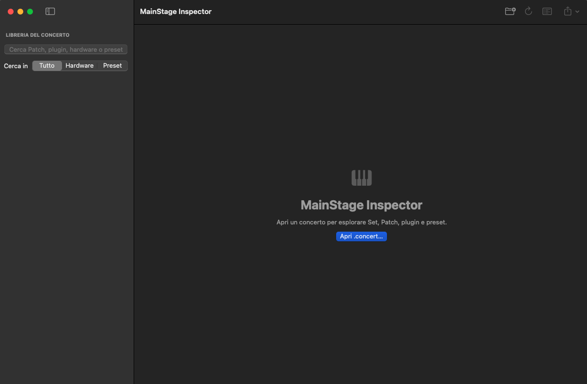
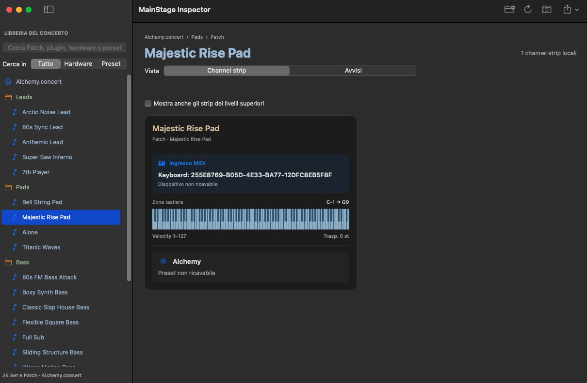

# MainStage Inspector

**English** · [Italiano](README.it.md)

First public release: **1.0.0**, build **13**. Created by **Luantani**.

A native macOS app for exploring Apple MainStage concert packages in read-only mode, without running audio plugins. Inspect Sets, Patches, channel strips, instruments, effects, supported saved presets and MIDI assignments. Includes search, concert summaries and HTML/JSON exports.

**App interface: Italian. Documentation: English and Italian.** This release does not include an English app interface.

## Download

**[Download MainStage Inspector 1.0.0 for Apple Silicon](https://github.com/smartrecovery73/mainstage-inspector/releases/download/v1.0.0/MainStage-Inspector-1.0.0-AppleSilicon.pkg)**

[Release and assets](https://github.com/smartrecovery73/mainstage-inspector/releases/tag/v1.0.0) · [English manual](https://github.com/smartrecovery73/mainstage-inspector/releases/download/v1.0.0/MainStage-Inspector-Manual-EN.html) · [Italian manual](https://github.com/smartrecovery73/mainstage-inspector/releases/download/v1.0.0/Manuale-MainStage-Inspector.html) · [Installer SHA-256](https://github.com/smartrecovery73/mainstage-inspector/releases/download/v1.0.0/SHA256SUMS.txt)

Use the `.pkg` file to install the app. GitHub’s “Source code” archives are intended for developers.

## Screenshots

The app starts with no concert loaded:



Concert analysis and channel strip details:



## Requirements and usage

The standalone installer requires **macOS 15 or later** and **Apple Silicon (M1 or later)**. MainStage, Python, Homebrew and Xcode do not need to be installed to analyze concerts with the packaged app.

The installer places the app in `/Applications`. Launch it and choose **Apri concerto** (Open concert) to select a `.concert` package. The app starts with no previous concert, search or selection restored. The bundled Italian manual is available in **Aiuto** (Help). Read the [English manual](packaging/Manual.en.html) or [Italian manual](packaging/Manuale.html) for more details.

This distribution is ad hoc signed. It has **no Developer ID signature or Apple notarization**. macOS may require approval in Privacy & Security or block the app according to local policies. Do not disable system security protections.

## Development and tests

The parser uses Python 3 and its standard library. Some compressed plugin states require libzstd, which is bundled with the standalone distribution.

```sh
python3 -m unittest discover -v
python3 mainstage_inspector.py /path/to/Example.concert --cli
python3 mainstage_inspector.py /path/to/Example.concert --json
python3 mainstage_inspector.py /path/to/Example.concert --html
```

To build the native interface, use an Apple Silicon Mac with Python and the Swift SDK provided by Xcode or Command Line Tools:

```sh
python3 build_mac_app.py
```

This development build uses your local Python installation. To create the standalone installer:

```sh
python3.13 package_macos.py
```

Packaging requires the **python.org CPython 3.13 framework**, libzstd at `/opt/homebrew/lib/libzstd.dylib` with its LICENSE/COPYING files, and Apple’s `swiftc`, `otool`, `lipo`, `install_name_tool`, `codesign`, `pkgbuild`, `productbuild`, `pkgutil` and `xar` tools. It does not download dependencies automatically. Output is written to `dist/`. Packaging checks signatures, relocatable dependencies, the Applications destination, and synthetic concert analysis before and after extracting the installer.

## Limitations

The concert format has no complete public specification. Plugin, preset and bypass recognition depends on the saved format. Unreadable data must not be interpreted as an absent plugin. Audio Unit names may depend on the components installed on the Mac. MIDI assignments describe saved data rather than physically connected devices. Overrides between Concert, Set and Patch levels are not fully resolved.

## Versioning

1.0.0 is the first public release. Earlier 10.x numbers were development versions. The internal build number continues at 13. Close earlier versions before installing. Installation over a development version, an empty startup and opening another concert were tested on the project Mac; this does not cover every macOS configuration.

## Repository contents

This repository contains source code, synthetic tests, screenshots and documentation. It does not contain personal concerts, generated reports, Apple manuals or prebuilt runtimes. Python and Zstandard are bundled during packaging with their respective licenses.

## Bug reports and suggestions

Open the [issue chooser](https://github.com/smartrecovery73/mainstage-inspector/issues/new/choose) and select **Report a bug** or **Suggest an improvement**. **You may write in English or Italian.** Include the app version, macOS version, Mac chip and steps to reproduce the problem. MainStage and plugin details are useful when relevant.

Do not attach complete concerts or reports containing private data. Check screenshots and error messages before sharing them. You do not need to share your concert to open an issue.

## License and author

Copyright (C) 2026 Luantani.

MainStage Inspector and its original documentation are licensed under **GNU GPL version 3 only** (`GPL-3.0-only`). See [LICENSE](LICENSE) for the full original English license text.

You may use, modify and sell the software. Distribution of derived works must comply with GPLv3, including providing recipients with the corresponding source as specified by the license, preserving copyright and license notices, and identifying modifications. Private modifications do not require publication, and changes do not have to be sent to the original author.

The software is provided without warranty, to the extent permitted by law. Third-party components retain their own licenses, included in the packaged app.
